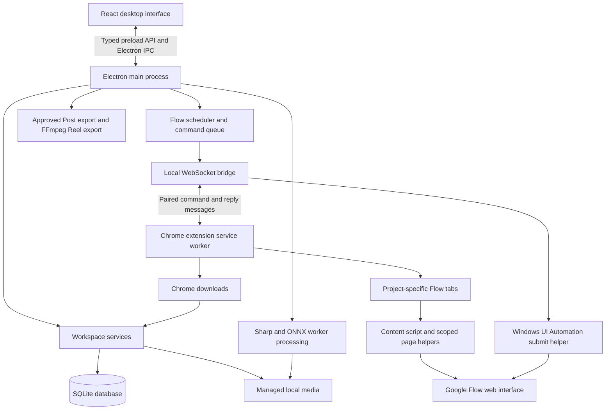

# Frame Studio

A Windows desktop studio for turning product photos into social media posts and reels. Organize products, reusable themes, and character references locally; generate media through your own Google Flow session; review results and export approved images or videos.

**Current version:** `0.13.0-preview.37` (preview).

Frame Studio is an independent personal project and is not affiliated with Google. Google Flow requires internet and an eligible account. Local libraries, image processing, review, and export work offline once the required tools are installed.

## Features

- **Projects and libraries:** product photos, reusable themes and prompts, character references, project snapshots, and storyboards.
- **Google Flow companion:** explicitly pair the desktop app with a signed-in Chrome tab, submit generation requests, collect matching results, and request image changes.
- **Multiple projects:** separate Flow tabs, queues, and result folders for each project.
- **Review:** browse generated versions, leave change instructions, approve selected results, and retry local cleanup.
- **Local image processing:** crop, rotate, resize, and repair supported visible logo regions using Sharp and the bundled MI-GAN model. Reconstructed regions require visual review; invisible SynthID removal is not provided.
- **Exports:** export approved Post images in batches or combine approved Reel clips with FFmpeg.
- **Desktop workspace:** local SQLite storage, managed media files, and persistent light/dark preferences.

The Flow integration depends on the live browser interface and account access. Included checks do not guarantee compatibility with every Flow account or future interface change. Manual media import remains available.

## Project overview for reviewers

Frame Studio addresses a practical creative workflow: product photographs, prompts, reference images, generated versions, and final exports otherwise have to be managed across local folders and browser tabs. The application brings these into a persistent desktop workspace while using the owner's existing Google Flow browser session for generation.

The application has three cooperating parts: a React desktop interface, an Electron application layer, and a Chrome companion extension. Local processing and persistence belong to the desktop application; online generation belongs to Google Flow. There is no hosted Frame Studio backend, application account system, or paid generative API integration.

**Technical focus:** desktop/browser integration, explicit cross-process contracts, persistent job recovery, controlled concurrency, local media processing, and approval-based exports. This is a Windows preview application; production readiness and live account compatibility should not be inferred from the presence of automated checks.

## Technology stack and responsibilities

Versions below describe this repository's pinned dependencies, not the latest available releases.

| Technology | Repository version | Responsibility |
| --- | --- | --- |
| React / React DOM | 19.2.7 | Component-based project, library, review, and Settings screens |
| TypeScript | 6.0.3 | Typed renderer, Electron services, and shared IPC contracts |
| Vite | 8.1.5 | Development server and production renderer bundle |
| Electron | 45.0.0 | Windows application window, process lifecycle, IPC, native dialogs, and local service access |
| Node.js | Development requirement: 24+ | Development scripts; the packaged application uses Electron's embedded runtime |
| SQLite through `node:sqlite` | Runtime-provided | Local structured data, revisions, attempts, reviews, exports, and saved Flow jobs |
| Chrome Extensions Manifest V3 | Companion 0.1.6 / adapter 0.1.6-fast.22 | Service worker, popup, tab routing, and scoped Flow page operations; minimum Chrome 116 |
| `ws` | 8.22.0 | Local WebSocket command/reply bridge between Electron and Chrome |
| Sharp | 0.34.5 | Image decoding, transforms, normalization, and export processing |
| ONNX Runtime Node | 1.31.1 | CPU inference for the bundled MI-GAN repair model |
| Node worker threads | Runtime-provided | Background image work with bounded concurrency and memory budgeting |
| Windows PowerShell / UI Automation | Windows-provided | Verify the Chrome window and invoke its accessible Start generation button |
| FFmpeg / FFprobe | Separately installed | Video inspection and local Reel encoding |
| Playwright / Playwright Core | 1.61.1 | Browser/desktop verification and browser-adapter code; the active app wiring uses the companion extension |
| electron-builder | 26.18.0 | Windows x64 NSIS installer and packaged resources |

## System architecture



### Desktop process boundaries

- **Renderer (`src/`):** displays libraries, project setup, review, export, and connection state. It calls a defined desktop API instead of opening the database or filesystem directly.
- **Preload (`electron/preload.cts`):** exposes typed operations through Electron's `contextBridge`. Methods such as `flow.generatePosts`, `flow.resume`, and `projects.save` map to named IPC channels.
- **Main process (`electron/main.cts`):** verifies the calling renderer, owns the workspace and native dialogs, starts the Flow companion bridge, and connects services to IPC handlers.
- **Storage services (`electron/storage/`):** implement domain validation, revisions, imports, job persistence, review state, and export rules.
- **Media workers (`electron/media/` and storage workers):** execute expensive image work outside the renderer so the interface can remain interactive.

The application currently instantiates `FlowCompanion` and `FlowScheduler` in `electron/main.cts`. Although `flow-browser.cts` also exists, describing the current generation path as a Playwright-controlled Chrome session would be inaccurate.

## How the Chrome extension operates

### Extension components

| File | Role |
| --- | --- |
| [`extension/manifest.json`](extension/manifest.json) | Declares Manifest V3, supported hosts, permissions, service worker, popup, and extension content security policy |
| [`extension/popup.js`](extension/popup.js) | User-facing connection and pairing controls |
| [`extension/background.js`](extension/background.js) | Owns the WebSocket session, validates tabs, routes commands, injects fixed helpers, and coordinates downloads |
| [`extension/project-tabs.js`](extension/project-tabs.js) | Associates software project IDs with separate Chrome tabs and verified Flow project URLs |
| [`extension/content.js`](extension/content.js) | Inspects the Flow DOM and implements supported actions such as project setup, reference checks, submission preparation, and result discovery |
| [`extension/editor-main.js`](extension/editor-main.js) | Updates a specifically marked prompt editor in the page's JavaScript context and verifies retained text |
| [`extension/upload-main.js`](extension/upload-main.js) | Assigns a reference image to a specifically marked file input using page-context `File` and `DataTransfer` objects |
| [`extension/result-download.js`](extension/result-download.js) | Associates an original-media download with the requested result and validates supported media URLs |

### 1. Explicit pairing with the desktop app

The user signs in to Flow in normal Chrome. Frame Studio starts a WebSocket listener bound to `127.0.0.1` on an operating-system-assigned port. It generates a 32-byte random token and presents a pairing code containing the port and token, valid for five minutes.

The extension popup receives that code and connects to `ws://127.0.0.1:<port>/companion`. The desktop validates the loopback host, Chrome extension origin, token, expiration, and supported Flow page. Successful pairing consumes the token. Heartbeats detect a lost session; disconnecting rejects pending commands and requires pairing again.

The extension operates within the existing signed-in browser session. It does not request cookie access or extract passwords. Google sign-in and verification remain user actions.

### 2. Commands and project ownership

Desktop commands include a unique request ID, action, payload, and, for project work, project ID. The service worker routes the command to the corresponding project tab and returns a reply containing the request ID and project ownership. The desktop rejects mismatched ownership.

Supported actions include `inspect`, `createProject`, `nameProject`, `prepare`, `attach`, `baseline`, `armSubmit`, `confirmSubmit`, `results`, and `download`. The service worker accepts a fixed action set; it does not expose a general-purpose remote JavaScript executor. Completed command IDs are cached within the connection to avoid repeating the same command when it is seen again.

Before browser work, the extension verifies that the tab remains on a supported Flow origin. New software projects receive separate Flow tabs and URLs, reducing the chance that one project's references or output will be assigned to another.

### 3. Prompt entry and reference uploads

The service worker injects `content.js` into Chrome's **isolated world** and exchanges messages with it. The content script identifies the relevant controls in the live Flow page. For operations that need the page's own JavaScript objects, the extension runs a fixed helper in the **main world**.

For prompt editing, a nonce identifies one editor. The helper sets a textarea value with its native setter and emits input/change events, or inserts text into a contenteditable element. It then checks that the complete prompt remains in the editor. Merely assigning text without confirming that Flow retained it is not treated as success.

For uploads, the desktop validates a supported reference image and sends its filename, MIME type, and Base64 bytes through the paired channel. The upload helper reconstructs a `File`, places it in a `DataTransfer`, assigns it to the nonce-marked input, and emits the expected events. The workflow waits for the reference attachment to appear in Flow. A local filename inside a prompt is never considered an uploaded image.

### 4. Verified native generation submission

Submission combines browser inspection with Windows accessibility:

1. The extension prepares a submission ticket for the selected Flow project.
2. The desktop calls the bundled PowerShell helper through `execFile` with a timeout and hidden helper window.
3. Windows UI Automation finds exactly one Chrome window with the expected title, checks that its process is Chrome, and verifies the address bar matches the requested project URL.
4. It finds exactly one visible, enabled **Start generation** button and invokes its accessibility `InvokePattern` after rechecking the address bar.
5. The extension checks for acknowledgement such as a cleared prompt, a new generation card, or generation progress.

This step does not use screen coordinates or global keyboard input. A successful button invocation alone is insufficient proof of submission. Ambiguous state is retained for recovery rather than triggering a second click. The exact accessibility labels also make this path sensitive to Chrome/Flow UI or language changes.

### 5. Result discovery and download

Before submission, the application saves a baseline of existing result IDs. Subsequent collection uses the project, expected output type, prompt context, and result identity to distinguish new output from older media.

For a supported direct link, the extension uses `chrome.downloads.download`. For Flow's original-size menu, it observes the download associated with that specific action. It then follows the identified Chrome download until completion or interruption.

The desktop derives a stable staging name from the project URL and result ID, checks for an existing completed or pending download, and validates the returned path. Files are staged under `Downloads/Frame Studio` and imported into managed project storage. Redirected paths, ambiguous associations, and unsupported destinations are rejected; manual import is the fallback. This prevents a lost response from automatically causing another download or importing an unrelated file.

### Extension permissions

| Permission or host scope | Usage |
| --- | --- |
| `activeTab` | Access to the tab explicitly selected through the extension action |
| `scripting` | Injection of the fixed content script and scoped editor/upload helpers |
| `downloads` | Start and track result downloads and save requested diagnostics |
| `storage` | Persist extension bookkeeping, including project/tab mappings |
| Supported `flow.google.com` and `labs.google` paths | Restrict browser operations to the supported Flow interface |
| Loopback host and `ws://127.0.0.1:*` connection policy | Communicate with the local desktop bridge |

The manifest does not request `cookies`, `debugger`, or unrestricted access to all websites. The bridge checks for an extension origin and possession of the pairing token; pairing is not an OAuth grant or a public Google API.

## Generation lifecycle and concurrency

A generation attempt is saved locally before browser submission. Its record contains the prompt/reference snapshot and is associated with a persistent Flow job. The coordinator records stages such as `preparing`, `submitting`, `waiting`, `downloading`, `complete`, and `needs-attention`.

Immediately before attempting submission, the attempt is durably marked `submission-uncertain`. This conservative state allows recovery even if the app closes or a reply is lost just after the browser submits. **Resume collects the existing request; Regenerate deliberately creates another attempt.** A distributed desktop/browser workflow cannot promise exactly-once remote execution after every failure, so the implementation avoids automatic repeat submissions when the outcome is unknown.

`FlowScheduler` maintains a coordinator per project and allows up to three reserved/submitted requests across projects. `FlowCommandQueue` serializes browser operations because the composer, selected tab, and native button interaction are shared resources. Result collection receives priority between uploads, with a fairness rule to avoid indefinitely starving other commands. Submission preparation, native invocation, and acknowledgement are kept together as an uninterrupted command turn.

Remote generation can therefore overlap while browser interaction remains serialized. Deleting or stopping one project is scoped to that project's local work; it does not imply cancellation of a generation already running on Google's service.

## Local data model and persistence

The default managed workspace is created under Electron's `userData` directory in a `workspace/` subfolder. SQLite stores structured metadata; image and video files live in managed directories. Keeping large media outside database rows supports normal filesystem processing and exports.

| Data group | Main records and purpose |
| --- | --- |
| Assets and imports | `assets`, `import_jobs`, and `asset_edits` track managed files and image edits |
| Products | Product records, linked assets, and trash records |
| Themes | Theme records, saved revisions, reference assets, and trash |
| Characters | Character records, reference assets, saved revisions, and trash |
| Projects | Project records, revisions, and asset relationships |
| Generation | `generation_attempts` preserves separate generated attempts and their state |
| Review and output | `scene_reviews`, `logo_reviews`, and `project_exports` track approval and exported results |
| Flow recovery | `flow_projects` and `flow_jobs` retain remote project mappings and collection state |

The database uses foreign keys, WAL journaling, full synchronous writes, and a busy timeout. Ordered migrations are tracked through schema metadata; the current schema version is 18. A database newer than the supported schema is rejected instead of being opened by incompatible code.

Project snapshots and revision records preserve the choices associated with earlier work when reusable libraries change. Managed-path validation rejects traversal and redirected files. Imports copy media into the workspace, so moving the original source photograph does not break an imported reference. Backups must include both the database and managed media.

## Image processing, review, and export pipeline

For Post output, imported media passes through local processing before becoming available for approval. Sharp handles image decoding and transforms. Supported visible Gemini logo patterns are checked against calibrated masks; difficult detected regions can use the bundled MI-GAN inpainting model through ONNX Runtime CPU inference. The user can select a repair area if automatic detection misses a visible mark.

Repair workers run through a shared queue. Capacity considers CPU parallelism, available memory, and image dimensions; duplicate processing of the same key is rejected. Worker progress represents processing stages, and the image becomes ready only after the final output is committed. ONNX Runtime telemetry is disabled before worker initialization. Repair reconstructs an estimated texture, so human review is required; this feature does not remove invisible SynthID.

Approval belongs to the selected saved image version. A new creative revision requires review again. Post batch export creates a new destination folder and writes images in product order; matching PNGs can be copied without re-encoding. Cancellation or changed approval rolls back partial batch output. Reel export uses local FFmpeg/FFprobe to inspect and combine approved clips according to the export settings.

## Security and failure handling

| Boundary or failure | Implemented response |
| --- | --- |
| Renderer access to desktop resources | `contextIsolation: true`, `sandbox: true`, `nodeIntegration: false`, and a typed preload API |
| Unexpected IPC caller or navigation | Main-window/frame/URL validation; new windows denied and untrusted navigation blocked |
| Unauthorized local bridge connection | Loopback-only listener, extension-origin check, expiring random pairing token, and one authenticated socket |
| Tab navigates away from Flow | Origin/project verification stops the operation |
| Missing or ambiguous browser control | Fail with an actionable error rather than guessing a target |
| Connection lost during submission | Preserve uncertain state; no automatic repeat Generate click |
| Partial or unrelated download | Result-specific identity, staging-path checks, and existing-download recovery |
| Cleanup fails or is interrupted | Image remains unapproved until processing is retried and reviewed |
| Missing FFmpeg tools | Reel export cannot proceed; local Post image export remains available |

These are concrete controls present in the implementation, not a claim of an independent security audit. References and prompts intentionally leave the machine when uploaded to Google Flow; local storage and repair do not require a Frame Studio cloud service.

## Engineering decisions and tradeoffs

- **Electron and React:** reuse a web UI while providing native filesystem, process, and media capabilities. The tradeoff is a larger application/runtime footprint.
- **Local SQLite and managed files:** support a single-user offline workspace without deploying a server. Cross-device synchronization and collaborative editing are outside the current scope.
- **A Chrome companion:** reuse the user's normal authenticated Flow session without handling credentials. The tradeoff is dependency on the live DOM and browser behavior.
- **Persistent job state:** recover existing requests after interruptions. The tradeoff is explicit attention/resume flows when remote submission cannot be proven.
- **Serialized browser work with overlapping generation:** protect shared UI state while permitting several remote requests to run. Browser interaction remains a throughput bottleneck.
- **Local CPU repair workers:** avoid a separate repair service and keep image work local. Processing time and concurrency depend on available hardware.
- **Human approval before export:** make the user responsible for product fidelity and reconstructed texture; automated processing does not establish creative correctness.

## Verification scope and current limitations

The repository includes isolated storage/restart tests, Flow transport and scheduler checks, Chrome extension tests, media-processing checks, desktop smoke scripts, and packaging validation. See the commands below and the additional focused scripts in `scripts/`. The existence of a test script does not mean it was executed against the current live Google Flow interface.

Current limitations include Windows-specific native submission, manually loaded Chrome extension installation, an unsigned installer, no automatic app updates, separately installed FFmpeg tools, and sensitivity to Flow UI/account changes. Browser safety warnings and Google verification require manual attention. A customized Chrome download location can require manual import. Local repair cannot guarantee the original texture, and generated media must be reviewed for product consistency.

### Suggested code-reading path

For an interview or technical review, start with [`src/App.tsx`](src/App.tsx) and [`src/Studio.tsx`](src/Studio.tsx), then follow the typed bridge in [`electron/preload.cts`](electron/preload.cts) and [`electron/contracts.cts`](electron/contracts.cts). Read [`electron/main.cts`](electron/main.cts) for service wiring, [`electron/flow-scheduler.cts`](electron/flow-scheduler.cts) and [`electron/flow-coordinator.cts`](electron/flow-coordinator.cts) for execution/recovery, and [`electron/flow-companion.cts`](electron/flow-companion.cts) alongside the extension for browser communication. Finally, inspect [`electron/storage/database.cts`](electron/storage/database.cts), [`electron/media/logo-queue.cts`](electron/media/logo-queue.cts), and [`electron/storage/exports.cts`](electron/storage/exports.cts) for persistence, processing, and output rules.


## Requirements

- Windows x64 for the desktop app and installer.
- Node.js **24 or newer**, npm, and Git for development.
- Google Chrome and your own signed-in Google Flow session for online generation.
- `ffmpeg` and `ffprobe` on `PATH` for Reel export. Post image export does not need them.

FFmpeg is not bundled with the installer. After installing both tools and restarting Frame Studio, verify them in a new terminal:

```powershell
ffmpeg -version
ffprobe -version
```

## Run locally

```powershell
git clone https://github.com/Smit-Kansagra/frame-studio.git
cd frame-studio
npm ci
npm run dev
```

`npm run dev` compiles the Electron code, starts Vite at `127.0.0.1:5173`, and opens the desktop app. Restart the command after changing Electron source.

To run a production build:

```powershell
npm run build
npm start
```

`npm run dev:ui` starts a browser-only UI preview; desktop storage and integrations require Electron.

## Connect Google Flow

1. Open Frame Studio Settings and select **Open companion extension folder**.
2. Open `chrome://extensions` in Chrome, enable **Developer mode**, and choose **Load unpacked** with that folder. For source development, use this repository's `extension/` directory.
3. Open your signed-in Flow workspace and refresh the tab.
4. Select **Connect Flow** in Frame Studio, copy the temporary pairing code, and paste it into the companion extension popup on the Flow tab.
5. Keep Chrome and Frame Studio open while generating and collecting results.

Pairing is revocable. Google verification prompts require your attention. See [the companion guide](extension/README.md) for generation, recovery, review, and cleanup details.

## Typical workflow

1. Create a theme with a master prompt and any visual references or storyboard scenes.
2. Create a project, add product photos, and choose a theme and optional character references.
3. Review the project settings and prompts, then generate through the connected Flow session or import downloaded media.
4. Review each result and request changes where needed. Post images finish local cleanup before approval.
5. Approve the desired versions and export images or combine approved Reel clips.

Back up the complete workspace shown in Settings with the app closed so the database and managed media stay together.

## Build a Windows installer

```powershell
npm ci
npm run package:win
```

The installer is written to `release/Frame-Studio-0.13.0-preview.37-x64-Setup.exe`. The version comes from `package.json`.

Alternatively, `npm run build:installer` writes into `release/<version>/`, which avoids replacing an open unpacked build. Installers are unsigned; automatic updates are not configured. Keep installers in GitHub Releases rather than committing them to the source repository.

## Development checks

| Command | Purpose |
| --- | --- |
| `npm run typecheck` | Check renderer and Electron TypeScript |
| `npm run build` | Type-check and build the production app |
| `npm run check:storage` | Isolated database, image, and persistence checks |
| `npm run check:products` | Product storage and restart checks |
| `npm run check:themes` | Themes, revisions, prompts, and image edits |
| `npm run check:characters` | Character references and persistence |
| `npm run check:projects` | Project setup and snapshots |
| `npm run check:flow` | Flow service checks |
| `npm run check:companion` | Companion transport checks |
| `npm run check:extension-browser` | Extension browser checks |
| `npm run check:reel-export` | Real local video export; requires FFmpeg and FFprobe |
| `npm run check:shell` | Built desktop UI checks; requires a build and desktop session |
| `npm run check:package-input` | Installer configuration and icon validation |
| `npm run check:package-output` | Default packaged output validation |

Checks may create disposable data under ignored `artifacts/`. Browser and desktop checks need permission to launch their applications. `npm run check:package` expects the default `release/win-unpacked/` output from `package:win`.

## Project structure

```text
src/             React interface and styles
electron/       Desktop process, IPC, storage, Flow integration, media workers
extension/      Chrome Flow Companion extension
scripts/        Development, packaging, and verification scripts
third-party/    Required model, metadata, and third-party license notices
build/          Generated installer icon
```

The stack uses Electron, React, TypeScript, Vite, SQLite, Sharp, ONNX Runtime, Playwright, and WebSocket transport. Dependency versions are pinned in `package.json` and `package-lock.json`.

Keep `third-party/migan/migan_pipeline_v2.onnx`: it is a required runtime asset, not an old build. Its pinned checksum, origin, and licenses are stored beside it. Additional attribution is in `third-party/gemini-watermark/`.

## Upload this local project to GitHub

For a new, empty GitHub repository, run these commands in PowerShell:

```powershell
cd C:\Users\kansa\Desktop\software
git init -b main
git add .
git status
git commit -m "Initial Frame Studio project"
git remote add origin https://github.com/Smit-Kansagra/frame-studio.git
git push -u origin main
```

Complete GitHub authentication when prompted. If Git asks for your identity, set `git config user.name "Your Name"` and `git config user.email "your GitHub email"`, then repeat the commit and push.

These initial-upload commands assume the remote has no commits. If it already contains files, clone it into a separate folder and copy this project's source into that clone, respecting `.gitignore`, then commit and push. Do not force-push over existing history.

For later changes:

```powershell
git add .
git commit -m "Describe your changes"
git push
```

The `.gitignore` excludes dependencies, compiled output, installers, verification caches, test screenshots, environment secrets, and temporary files. Review `git status` before committing. Keep the lockfile, source, checks, extension, model, and third-party notices in Git.

See [GitHub's existing-project upload guide](https://docs.github.com/en/migrations/importing-source-code/using-the-command-line-to-import-source-code/adding-locally-hosted-code-to-github).


